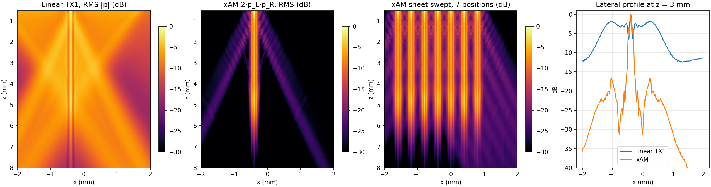

# Advanced — xAM Sound Sheet from a Row-Column Probe

Reproduces the transmit sequence of *nonlinear sound-sheet microscopy* (Heiles et al.,
Science 2025): a row-column addressed (RCA) probe fires **cross-amplitude-modulated
(xAM) X-waves** whose nonlinear signal lives only in a thin sheet. Every step is a
linear pressure field plus point-by-point arithmetic with [`Field`](../../user-guide/fields.md).

[Source on GitHub](https://github.com/EstebanRivera08/eSDIva/blob/main/examples/advanced/rca_xam_sound_sheet.py)



## The probe

`RowColumnAddressedTransducer` crosses N column bars with N row bars on one face (2N
channels instead of N²). Both sets are ordinary `LinearArrayTransducer`s:

```python
rca = RowColumnAddressedTransducer(n_elements=64, element_width_mm=0.09, kerf_mm=0.01,
                                   no_sub_x=1, no_sub_y=32, frequency_Hz=15.6e6)
rca.columns   # transmit here (bars along y, steer in x)
rca.rows      # the crossing array, e.g. for Reception(rca.columns, rca.rows)
```

## The xAM sequence

A 48-element sub-aperture is split in two halves that emit plane waves tilted toward each
other at ±20°. Three pulses: **TX1** both halves, **TX2** left only, **TX3** right only.
Same delays for all three, so they share one time axis and subtract sample by sample:

```python
linear = tx1 - tx2 - tx3          # tissue echo: cancels (1.5e-5 of peak, float32)
xam = tx1**2 - tx2**2 - tx3**2    # quadratic scatterer: 2·p_L·p_R survives
```

eSDIva simulates the three **linear** fields. The square is a **model** of the bubble's
leading nonlinear response, not simulated nonlinear propagation. `2·p_L·p_R` is non-zero
only where both pulses are present **at the same instant**: a sheet around the bisector.

## What it shows

| Measured (RMS over time) | Linear TX1 | xAM |
|---|---|---|
| Peak outside ±0.6 mm of the bisector, z = 3 mm | −1.8 dB | −16.6 dB |
| −6 dB width on the bisector, z = 2–6 mm | 0.08 mm (one interference fringe) | 0.16 mm, the same at every depth |

The linear X-wave has a narrow central fringe, but equally bright fringes fill the whole
crossing zone. xAM keeps only the overlap of the two pulses, so the sheet keeps the same
width down to where the halves stop crossing (`a / tan α` ≈ 6.6 mm). The 0.16 mm sheet
here is wider than the paper's ~0.1 mm. This run does not explain the gap. Two untested
hypotheses: the metric (RMS of the whole `2·p_L·p_R`, no receive filter or beamforming)
and the pulse and aperture differ from the paper's. Treat the number as this setup's,
not as a reproduction of theirs.

## Sweeping the sheet by moving it

Sliding the sub-aperture along a homogeneous medium translates its field, so the sheet is
**moved** with `Field.transform` instead of re-simulated. One re-simulated slide of
8 elements agrees with the moved sheet to **2.5e-6 of peak**. Seven sheets swept 4 elements
apart are summed as power (they are fired at different times).

## Run

```bash
uv run examples/advanced/rca_xam_sound_sheet.py
```

About 7 s. Set `ESDIVA_SAVE_FIG=1` to write the figure instead of showing it.
