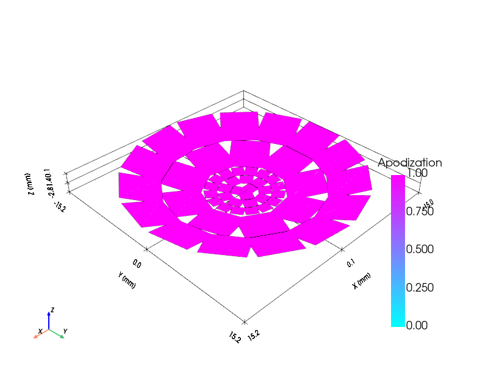
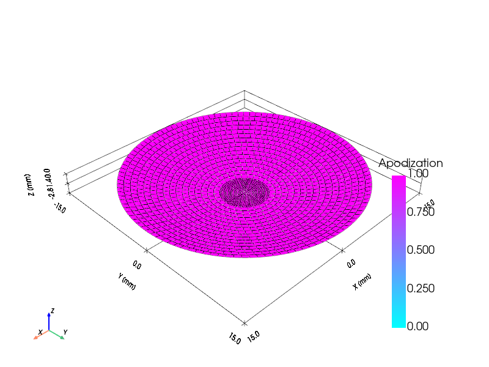
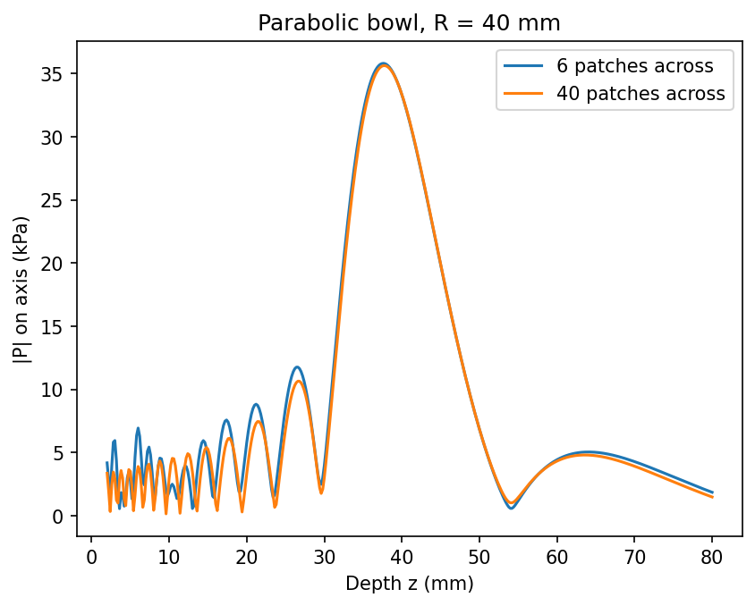

# Application — Any curved element: a parabolic bowl, and how fine to tile it.





Run it: `uv run examples/applications/custom_surface_element.py`

```python title="examples/applications/custom_surface_element.py"
--8<-- "examples/applications/custom_surface_element.py"
```
