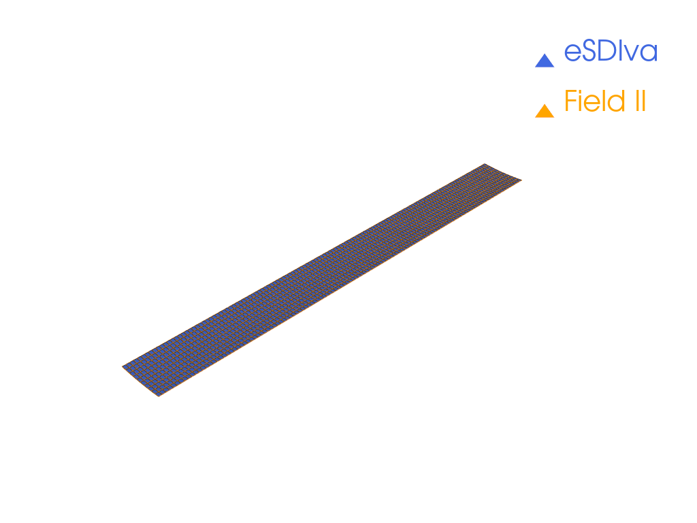
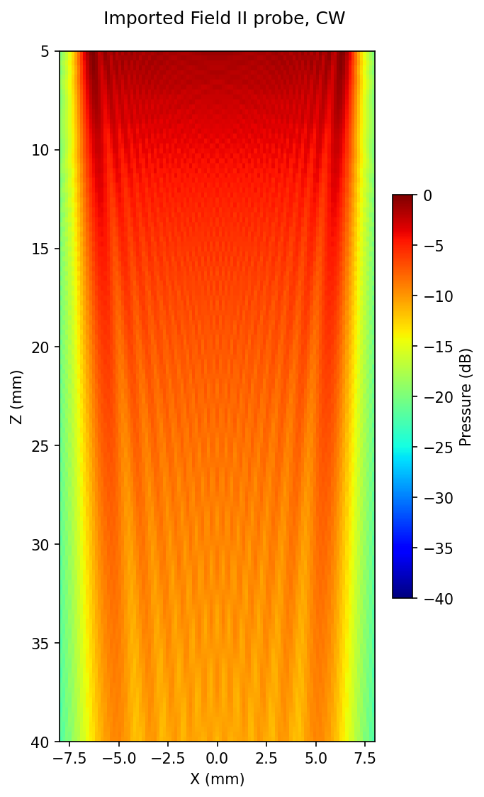

# Application — Reuse a Field II probe in eSDIva.




Run it: `uv run examples/applications/import_fieldii_probe.py`

```python title="examples/applications/import_fieldii_probe.py"
--8<-- "examples/applications/import_fieldii_probe.py"
```
