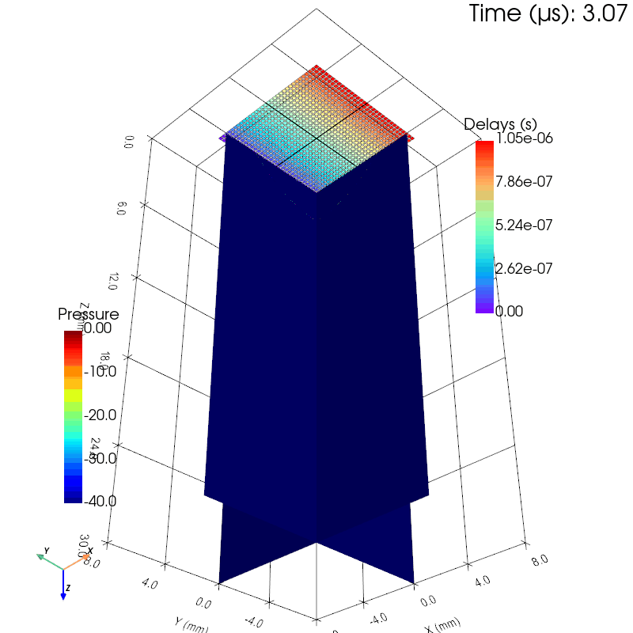

# Application — A steered plane wave from a matrix array, animated in 3-D.



Run it: `uv run examples/applications/matrix_steered_pw_3d.py`

```python title="examples/applications/matrix_steered_pw_3d.py"
--8<-- "examples/applications/matrix_steered_pw_3d.py"
```
