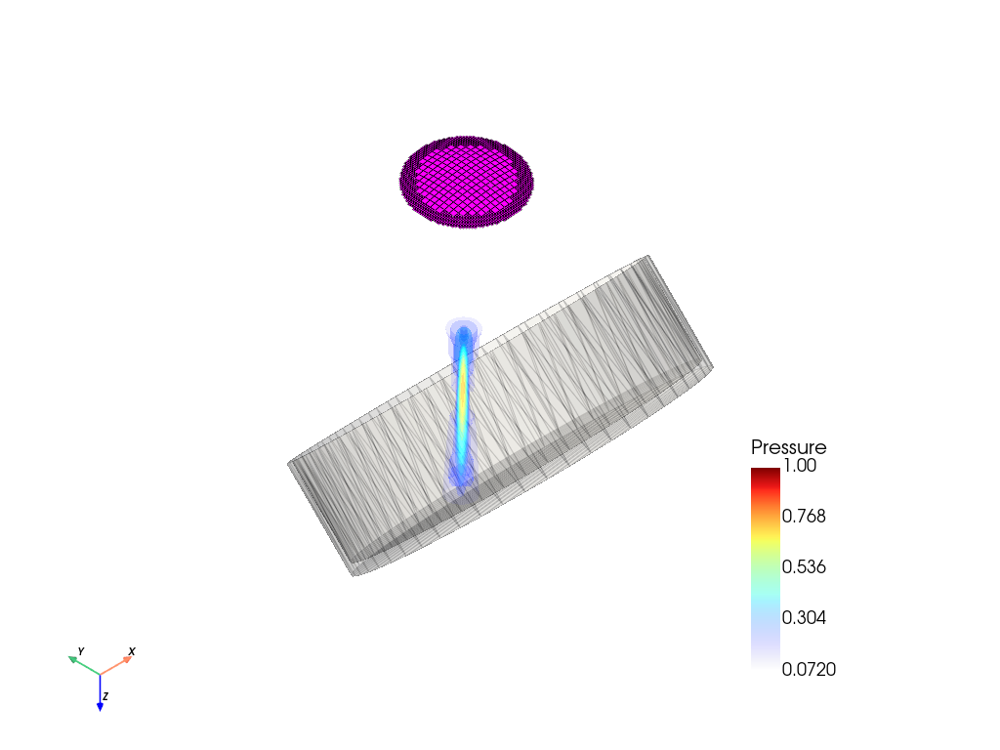

# Application — Place a focused transducer's beam inside a lab setup (STL mesh).



Run it: `uv run examples/applications/petri_dish_setup.py`

```python title="examples/applications/petri_dish_setup.py"
--8<-- "examples/applications/petri_dish_setup.py"
```
