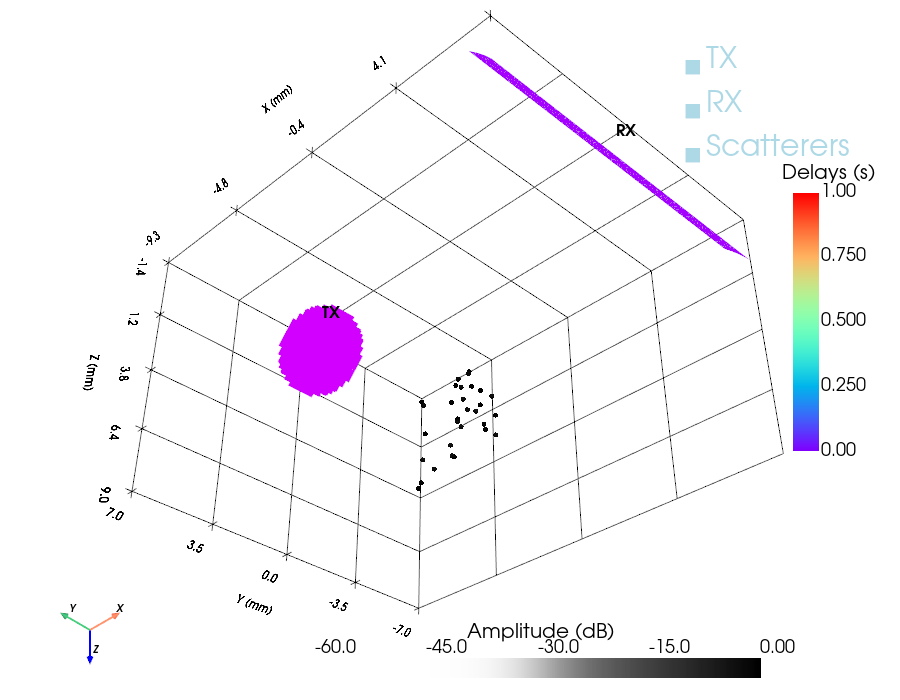
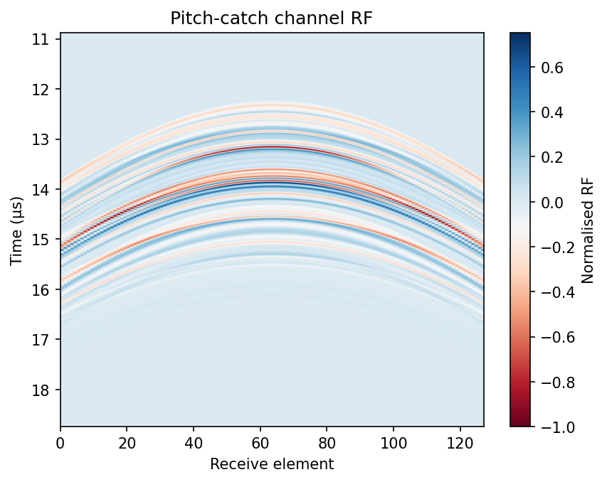

# Application — Pitch-catch: one probe transmits, another one receives.




Run it: `uv run examples/applications/pitch_catch_two_probes.py`

```python title="examples/applications/pitch_catch_two_probes.py"
--8<-- "examples/applications/pitch_catch_two_probes.py"
```
