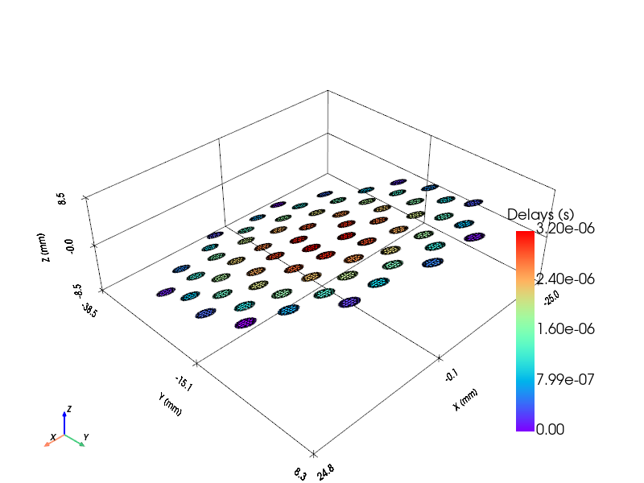
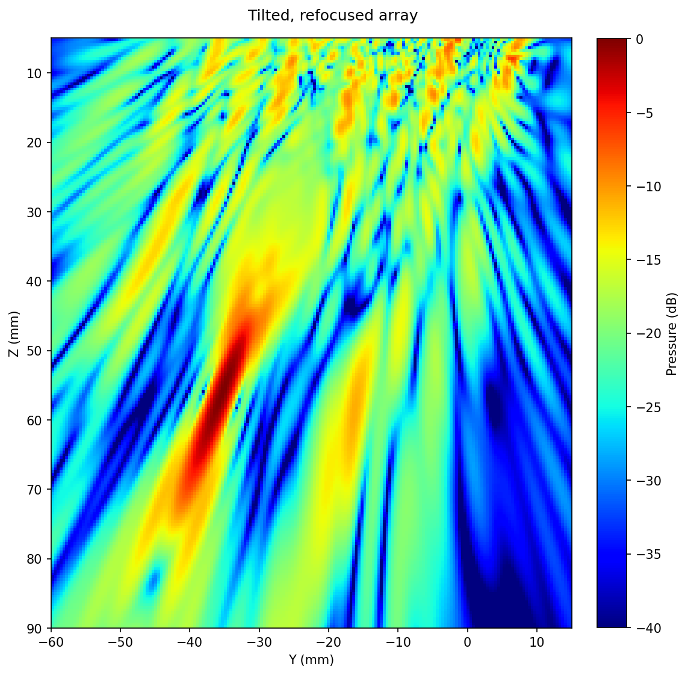

# Application — Move a probe in space, then refocus it.




Run it: `uv run examples/applications/transform_and_refocus.py`

```python title="examples/applications/transform_and_refocus.py"
--8<-- "examples/applications/transform_and_refocus.py"
```
