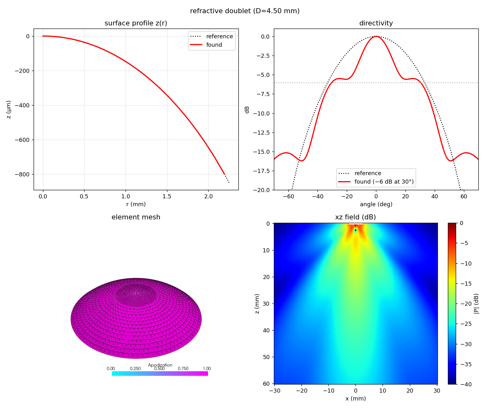
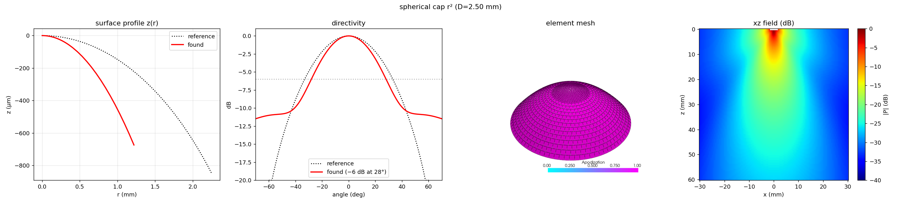
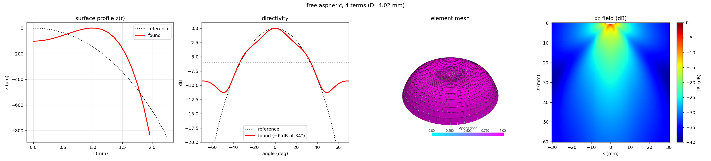

# Example 23: A Diverging Multilens Element as a Rigid Cap

The multi-lens array of Nardone et al. (*Nat. Commun.* 2025, s41467-025-64911-z)
widens each element's beam with a diverging epoxy/silicone doublet lens. eSDIva is
linear and homogeneous — **no refraction** — so the lens can only be modelled as a
curved **rigid cap** whose surface sag reproduces the same aperture phase. This example
builds three candidate caps and compares each against the paper's measured directivity
(a Bessel bell crossing **−6 dB at 33.17°**), using
[`visualize_element`][esdiva.plotting.visualize_element]:

1. **refractive doublet** — the paper's lens, collapsed through a refractive-index
   (Snell) model to one effective cap `z(r) = −(n₂−n₁)·(R−√(R²−r²))` (no optimization).
2. **spherical cap (r²)** — a single convex term `z(r) = −λ·c₀·(r/R)²`, with `c₀` and the
   diameter fitted freely (multistart over the diameter).
3. **free aspheric** — four even-power terms `z(r) = −λ·Σ cₖ(r/R)^{2(k+1)}`, fitted
   freely including the diameter (coefficients may go negative → a non-convex aspheric).

[Source on GitHub](https://github.com/EstebanRivera08/eSDIva/blob/main/examples/example23_optimize_radial_element.py)

---

## The parametric surface

An axisymmetric cap is **even in `r`** (symmetric about the axis, apex pinned to
`z = 0`), so only even powers appear — a Taylor expansion of `z(r²)`:

```python
import numpy as np

C0, FC = 1540.0, 1e6
LAMBDA_MM = C0 / FC * 1e3

def sag_of(coeffs, diameter_mm):
    r_ap, c = diameter_mm / 2 * 1e-3, np.asarray(coeffs, float)
    return lambda r: -LAMBDA_MM * 1e-3 * sum(
        c[k] * np.clip(np.asarray(r, float) / r_ap, 0, 1) ** (2 * (k + 1))
        for k in range(len(c))
    )
```

With **non-negative** coefficients every term increases outward, so `z(r)` decreases
monotonically — a convex *diverging* cap (apex at the centre). Allowing negative
coefficients lets a central dimple form (the free aspheric).

---

## Fitting to the directivity

```python
from scipy.optimize import minimize
from scipy.special import j1
from esdiva import Emission

# loss = mean-squared dB mismatch against the jinc bell inside the main lobe (±50°),
# with BOUNDED Nelder–Mead — the bounds keep D and the coeffs in range directly;
# clipping them inside the loss would flatten the objective past the edge and the
# simplex would drift onto that plateau. With a FREE diameter the loss vs D is
# multimodal, so the free-aspheric fit restarts from several diameters (multistart)
# and keeps the lowest-MSE result — a single start is not reproducible.
res = minimize(loss, x0, method="Nelder-Mead",
               bounds=[(2.5, 5.5)] + [coeff_bounds] * n_terms)
```

!!! note "Well-posedness"
    Matching the main lobe alone is **under-determined** — a smooth convex cap and a
    central-dimple aspheric fit the same bell, and with a free diameter Nelder–Mead can
    even walk to the diameter bound. **Multistart** over the diameter (restart from
    several diameters, keep the lowest-MSE basin) makes the fit reproducible. The
    single-term **sphere** has no interior optimum and runs to the smallest allowed
    aperture — an honest corner solution; the richer **free aspheric** finds a true
    interior minimum.

---

## The three caps

Each is shown with the same four panels: **surface profile** `z(r)` and **directivity**
(found solid-red vs reference dotted-black), the patch **mesh**, and the **xz** pressure
plane. The refractive doublet reaches ~30°, the free aspheric ~34°, and the single-term
sphere shrinks to the smallest allowed aperture (~29°): a lone `r²` cap has no interior
optimum — it only widens by getting smaller — so a single rigid cap cannot cleanly match
the bell, which the paper's real multilens does.




