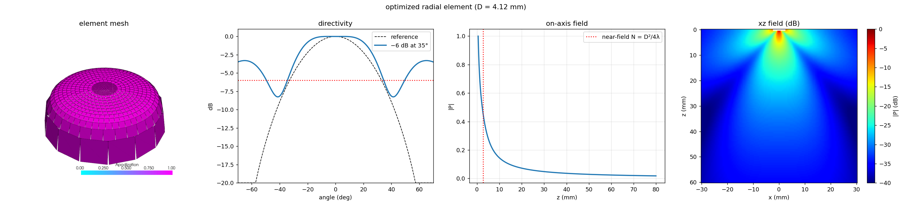

# Example 23: Optimize a Radial-Profile Element

Shapes the surface `z(r)` of a single
[`RadialProfileTransducer`][esdiva.transducers.RadialProfileTransducer] so its
emitted beam matches a target **−6 dB half-angle**. The surface is a polynomial
sag `z(r) = −λ · Σ cₖ (r/R)^{2(k+1)}`; `scipy.optimize` tunes the diameter and the
ten coefficients to fit an ideal Bessel (jinc) directivity, and
[`visualize_element`][esdiva.plotting.visualize_element] shows the result — mesh,
directivity, on-axis field, and `xz` plane — in one figure.

This is a design loop: a convex (divergent) cap widens the beam, so the optimizer
settles on a dome whose `−6 dB` half-angle lands on the target.

[Source on GitHub](https://github.com/EstebanRivera08/eSDIva/blob/main/examples/example23_optimize_radial_element.py)

---

## Step 1 — Target and parametric profile

```python
import numpy as np
from esdiva.transducers import RadialProfileTransducer

C0, FC = 1540.0, 1e6
LAMBDA_MM = C0 / FC * 1e3
TARGET_HALF_DEG, N_COEFFS = 33.0, 10

def sag_of(coeffs, diameter_mm):
    r_ap, c = diameter_mm / 2 * 1e-3, np.asarray(coeffs, float)
    return lambda r: -LAMBDA_MM * 1e-3 * sum(
        c[k] * np.clip(np.asarray(r, float) / r_ap, 0, 1) ** (2 * (k + 1))
        for k in range(len(c))
    )
```

`RadialProfileTransducer` pins the highest point of the profile to `z = 0`; with
positive coefficients the centre is forward and the rim recedes — a convex,
diverging dome.

---

## Step 2 — Fit the directivity

```python
from scipy.optimize import minimize
from scipy.special import j1
from esdiva import Emission

def directivity_db(element):
    th = np.deg2rad(ANGLE)
    pts = np.stack([35.0 * np.sin(th), np.zeros_like(th), 35.0 * np.cos(th)], 1)
    p = np.abs(Emission(element, fs=100e6, c=C0, monochromatic=True)(pts)[0]).squeeze()
    return 20 * np.log10(p / p.max())

# loss = mean-squared dB mismatch against the jinc bell inside ±45°, minimized
# over (diameter, 10 coefficients) with Nelder–Mead.
```

A coarse `no_sub_diameter` keeps each of the hundreds of trial evaluations fast;
the final element is rebuilt at full resolution.

---

## Step 3 — Visualize the optimized element

```python
from esdiva.plotting import visualize_element

el = RadialProfileTransducer(diameter_mm=D, surface_sag_m=sag_of(coeffs, D),
                             frequency_Hz=FC, no_sub_diameter=30)
visualize_element(el, c_m_s=C0, reference=(ANGLE, reference_db),
                  title=f"optimized radial element (D = {D:.2f} mm)")
```

The four panels: the patch **mesh**; the **directivity** against the target bell
with the `−6 dB` half-angle marked; the **on-axis** `|P|` decaying monotonically
(the beam diverges, no focus); and the **xz** pressure plane.


