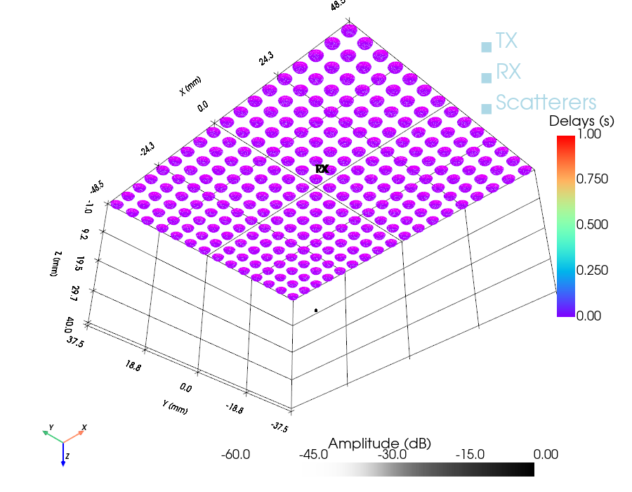
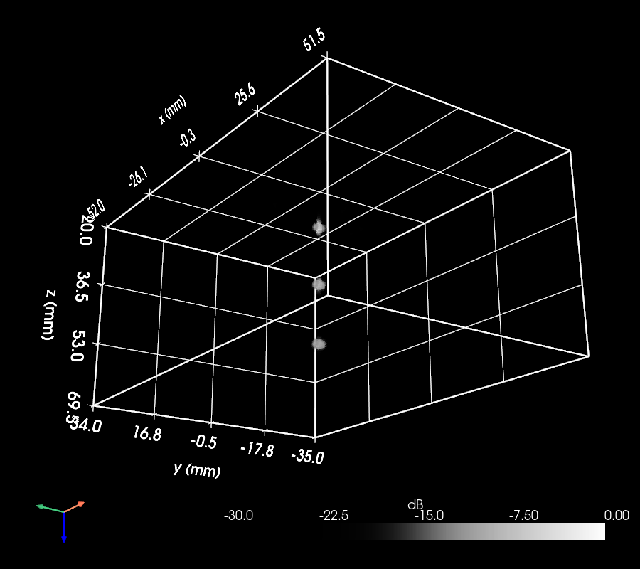
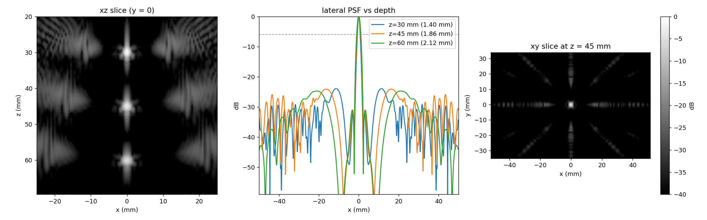

# Example 24: Depth-Resolved Multilens Matrix Point PSF

[Example 23](example23_optimize_radial_element.md) fitted a single rigid cap to the
diverging multilens element of Haidour et al. (*Nat. Commun.* 2025, s41467-025-64911-z).
The paper builds a large 3-D imaging probe by tiling **252** of these elements on an
**18×14** grid at **5.48 mm** pitch, driven at **1 MHz**, and characterises its
point-spread function **versus depth** (their **Fig. 2 / Supplementary Fig. 2**). The
acquisition is a **synthetic-aperture** sequence: the **16 elements of the central 4×4
block** each fire one diverging wave in turn, and **every element of the whole probe
receives** with uniform unit apodization (a fixed full aperture, not a focused F-number).
The 16 single-element echoes are compounded coherently on receive to synthesise a focus
everywhere. This example reproduces it with
[`CustomTransducer`][esdiva.transducers.CustomTransducer] (252 copies of the example-23
free-aspheric cap), fires the 16-source sequence at three point targets, delay-and-sums the
compounded echoes into a 3-D volume, and renders it the way the paper does — grayscale, in
dB, with a sigmoid opacity transfer function over a −30 dB display window.

[Source on GitHub](https://github.com/EstebanRivera08/eSDIva/blob/main/examples/example24_multilens_matrix_psf.py)

---

## Assembling the matrix

The diverging cap is reused straight from example 23 (same fit), so a change to the lens
there flows through here. 252 curved caps × 16 transmits is heavy — keep `NO_SUB`
modest, and preview the geometry with `sim.show()` before the simulation.

```python
from example23_optimize_radial_element import optimized_aspheric
from esdiva.transducers import CustomTransducer

element = optimized_aspheric(no_sub_diameter=20)  # one diverging cap
# 18×14 centres on a 5.48 mm grid → positions_mm (252, 3)
tx = CustomTransducer([element] * 252, positions_mm, frequency_Hz=1e6)
rx = CustomTransducer([element] * 252, positions_mm, frequency_Hz=1e6)
```

TX and RX are separate copies of the same geometry. Both apertures get a 2-cycle 1 MHz
impulse response (bare drive) so the pulse-echo spectrum is band-limited.



---

## The 16-source diverging sequence

Each of the 16 central elements (the middle 4×4 block) fires one diverging wave, driven by
a **one-hot** apodization so only that element emits while **every** element receives. The
16 events run through [`sequence_rf`][esdiva.reception.Reception.sequence_rf] and are then
compounded by [`das_volume`][esdiva.beamforming.das_volume]. Receive uses a **fixed full
aperture** (rect weighting, every element at every depth) — the paper's uniform unit
apodization — so the broad element directivity, not a focused F-number, sets the effective
aperture.

---

## Where does a lens element sit for the beamformer?

The decisive detail is the element's **acoustic datum**. A rigid diverging cap has its apex
at `z = 0` and its rim recessed to `z < 0`, but it radiates a spherical wave whose centre of
curvature — the **virtual acoustic source** — lies *behind* the aperture.
[`RadialProfileTransducer.virtual_source_m`][esdiva.transducers.RadialProfileTransducer]
returns that point by a least-squares circle fit of the element's own surface (here
≈ **−1.8 mm**). Referencing the delay-and-sum to the aperture plane (`z = 0`) instead
mis-times every echo by the lens's own curvature and defocuses the compounded transmits.

The example references **both** the transmit virtual source and the receive element position
to that depth, and removes the constant `2|z_vs|/c` round-trip pedestal it introduces with
`t_offset_s` (so the targets still beamform to their true depth). A sweep over the three
candidate datums — aperture plane, rim, virtual source — shows the lateral −6 dB width
collapse as the datum moves to the virtual source:

| depth | `z = 0` | rim | **virtual source** |
|------:|--------:|----:|-------------------:|
| 30 mm | 3.25 mm | 2.52 mm | **1.40 mm** |
| 45 mm | 2.84 mm | 2.38 mm | **1.86 mm** |
| 60 mm | 2.51 mm | 2.31 mm | **2.12 mm** |

The monotone ordering (aperture plane worst, virtual source best) is the discriminating
evidence that the lens curvature — not the array aperture — set the earlier ~2.5 mm lobe.

---

## The Fig. 2-style volume render

The beamformed volume is envelope-detected along depth, log-compressed to dB, and
volume-rendered with PyVista using a **grayscale** colormap, a **sigmoid** opacity transfer
function over a **−30 dB** display window (lobes opaque, the −30 dB background transparent),
and the **`"smart"`** volume mapper (ray-cast). A dark theme (black background, **all text
white** — ruler,
colorbar, box, axes) with the z axis pointing **down** (`camera.up = (0, 0, −1)`, the
ultrasound depth convention) puts the probe at the top and the three targets below. The
render box is the paper's **104 × 70 mm** lateral phantom, framed over the 20–70 mm depth
range on a **0.5 mm** grid — the main lobe is ~1 mm, so 1 mm voxels render it ~1 voxel wide
(blocky), while 0.5 mm puts 2–3 samples across it so the spots render smooth; the main lobes
are measured separately on fine 0.1 mm planes through each target.



Three panels give the quantitative view: the xz slice through the three targets, the lateral
PSF profiles at each depth with the **−6 dB** resolution marked, and the xy grating-lobe star.



### How close is this to the paper?

With the virtual-source datum the lateral −6 dB resolution is **1.40 mm at 30 mm**, widening
to **2.12 mm at 60 mm** as the fixed array subtends a smaller angle with depth — the shallow
value is close to the paper's quoted **1.06 mm**. The peak grating lobe sits at about
**−24 dB** (paper **−22.4 dB**), and the eight-arm grating geometry matches. The axial
resolution is ~1.3 mm, pulse-limited by the 2-cycle burst. The residual gap to 1.06 mm lives
in the single-rigid-cap approximation of the real two-material lens and in the paper's
unpublished *Beamforming processing*, so this example reproduces the measurable array physics
and the depth trend without claiming to match the raw main-lobe width exactly.

!!! note "Grating lobes are expected here"
    The 5.48 mm pitch is **3.56 λ**, far above the λ/2 that suppresses grating lobes, and a
    diverging element does not taper them the way a large flat element would. The regular
    off-axis replicas in the PSF (the star at ±11–13 mm in the xy slice) are those grating
    lobes — a real property of this coarse, large-pitch matrix, not a simulation artefact. A
    finer pitch or stronger element directivity would push them down.
