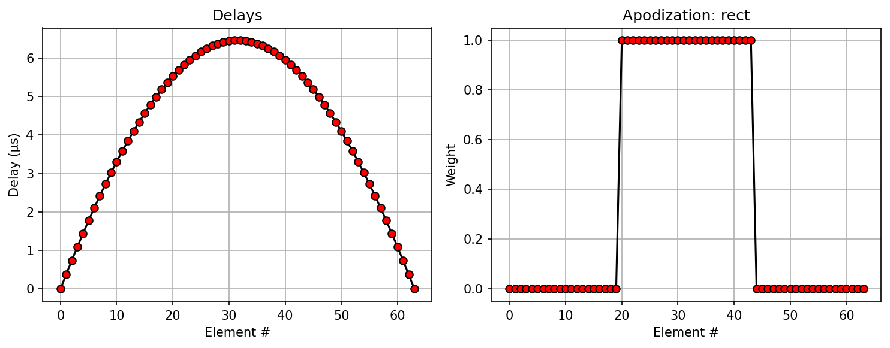
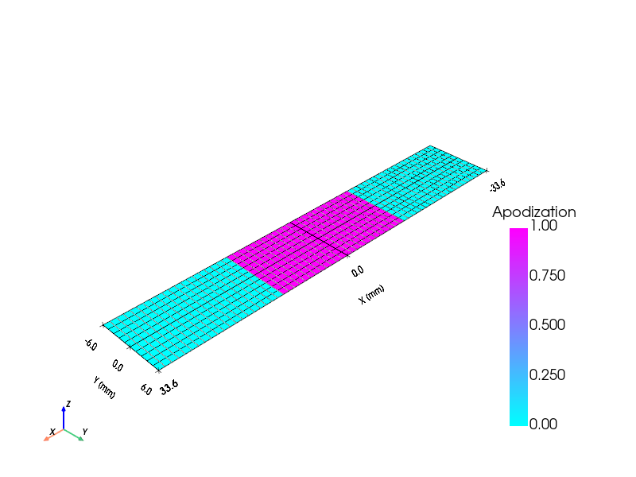
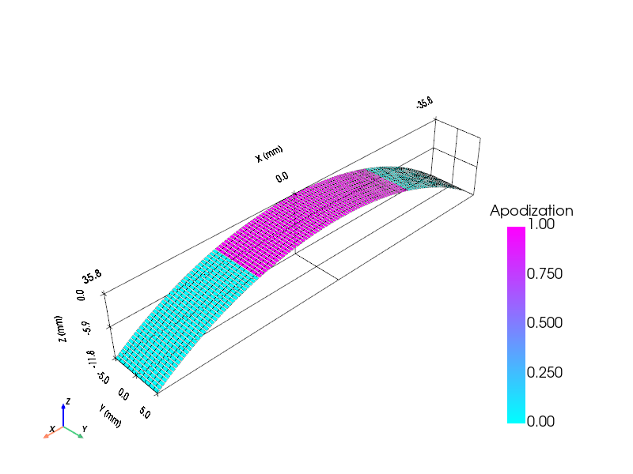
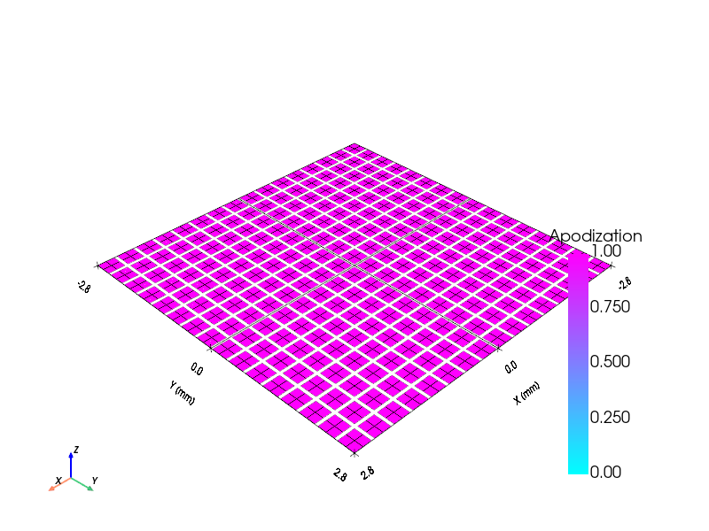
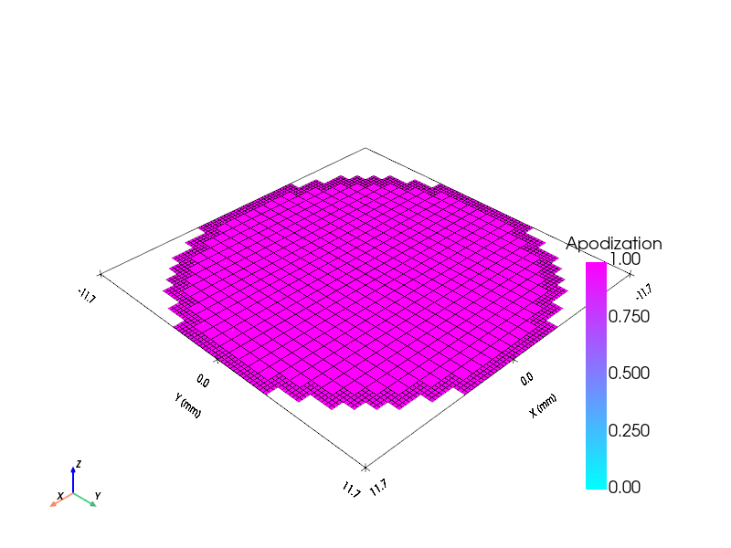
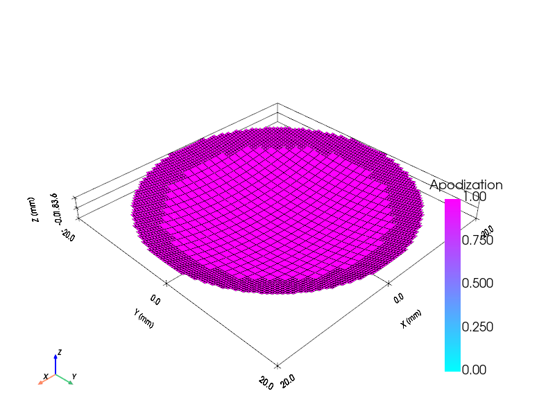

# Learn 01 — Transducers: an aperture is a set of small flat patches.








Run it: `uv run examples/learn/01_transducers.py`

```python title="examples/learn/01_transducers.py"
--8<-- "examples/learn/01_transducers.py"
```
