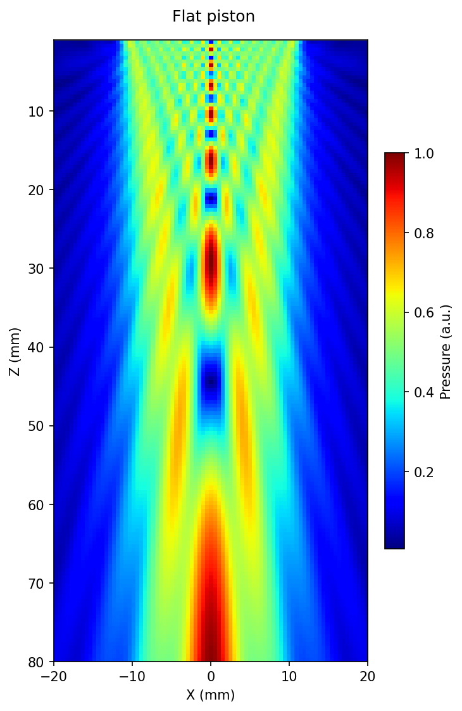
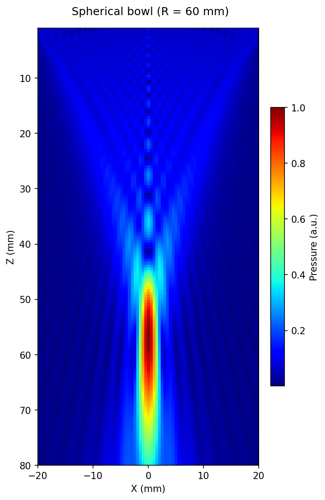

# Learn 02 — Continuous-wave field of a flat piston and a focused bowl.




Run it: `uv run examples/learn/02_piston_and_bowl_cw.py`

```python title="examples/learn/02_piston_and_bowl_cw.py"
--8<-- "examples/learn/02_piston_and_bowl_cw.py"
```
