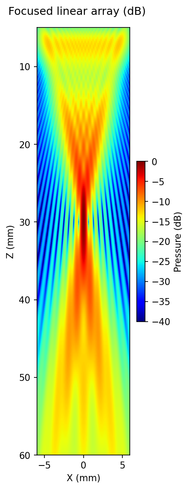

# Learn 03 — Electronic focusing: the focal spot width is about λ·F/D.



Run it: `uv run examples/learn/03_array_focusing_cw.py`

```python title="examples/learn/03_array_focusing_cw.py"
--8<-- "examples/learn/03_array_focusing_cw.py"
```
