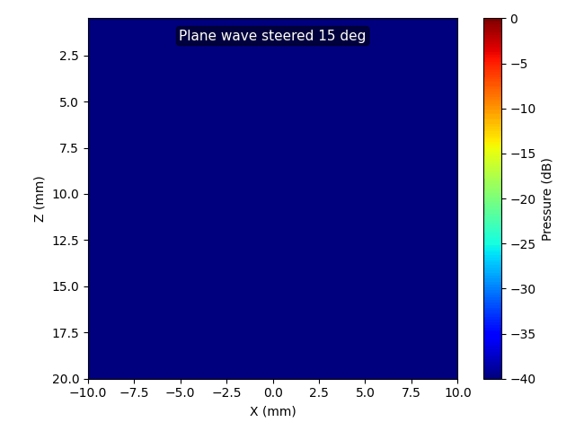
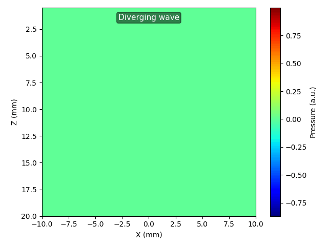

# Learn 04 — Transient pulse: the delay law shapes the wavefront.




Run it: `uv run examples/learn/04_plane_vs_diverging_wave.py`

```python title="examples/learn/04_plane_vs_diverging_wave.py"
--8<-- "examples/learn/04_plane_vs_diverging_wave.py"
```
