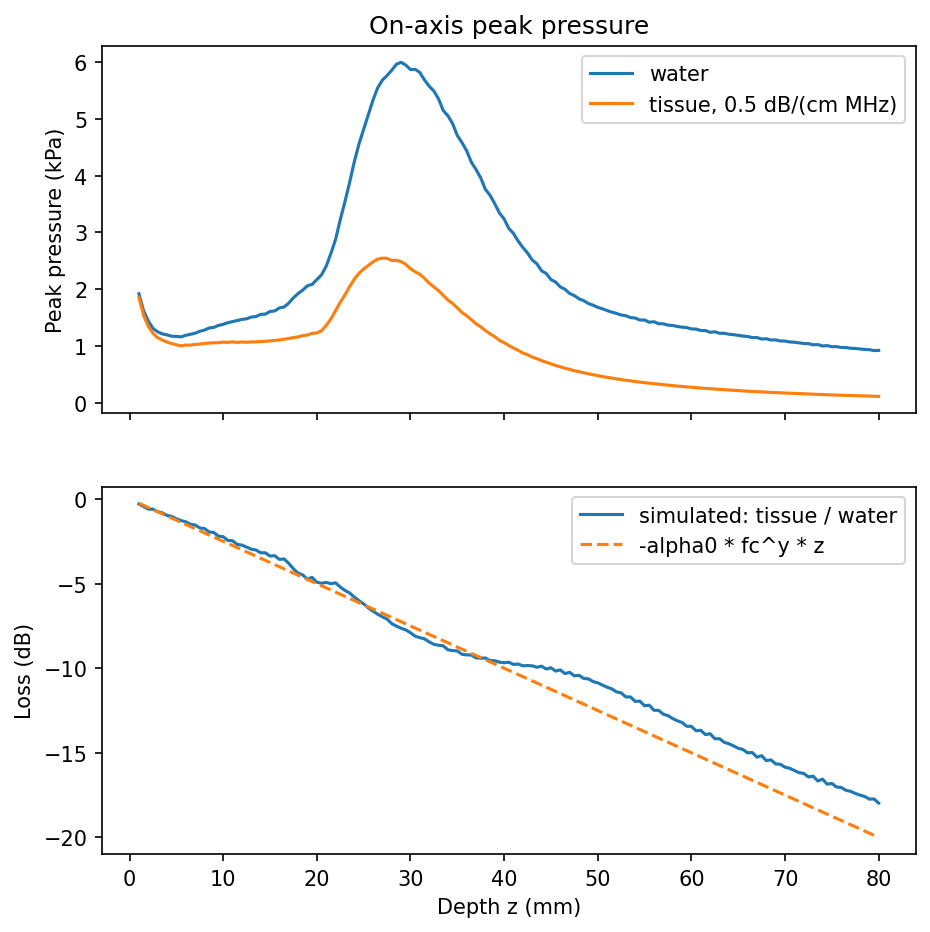

# Learn 05 — Tissue attenuation: the beam loses α·f^y dB per cm.



Run it: `uv run examples/learn/05_attenuation.py`

```python title="examples/learn/05_attenuation.py"
--8<-- "examples/learn/05_attenuation.py"
```
