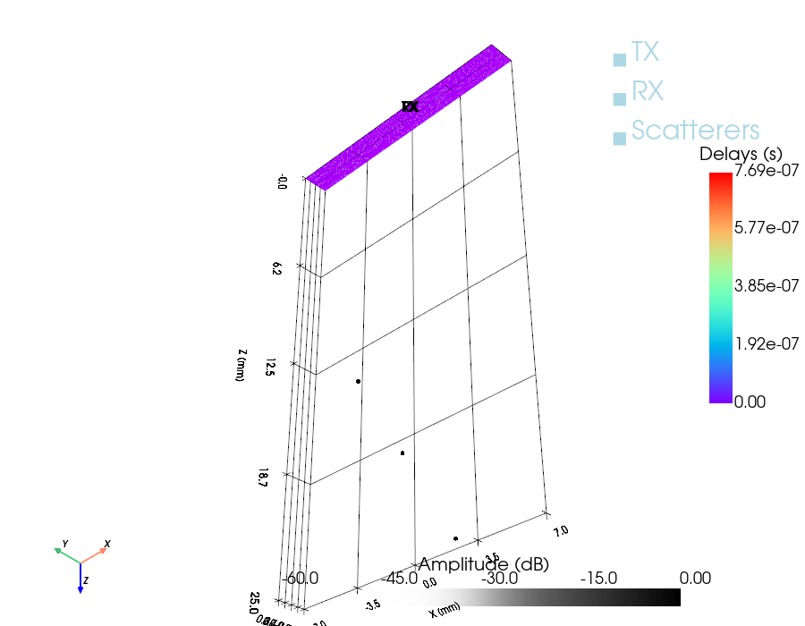
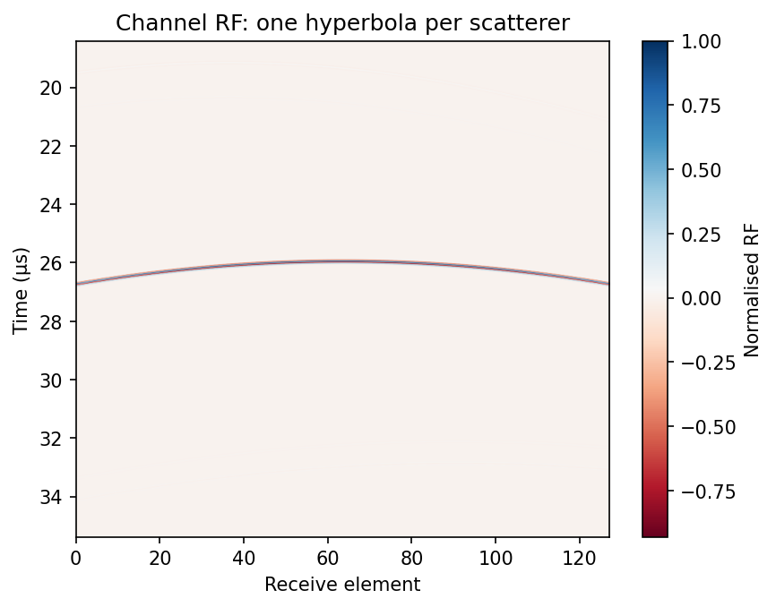

# Learn 06 — Pulse-echo RF: what each receiving element records.




Run it: `uv run examples/learn/06_pulse_echo_rf.py`

```python title="examples/learn/06_pulse_echo_rf.py"
--8<-- "examples/learn/06_pulse_echo_rf.py"
```
