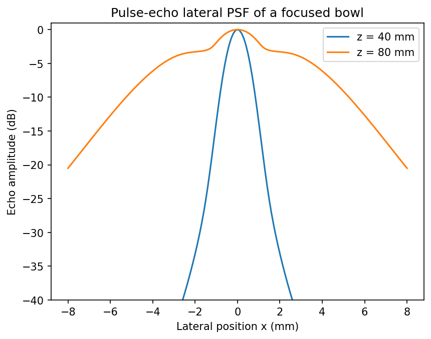

# Learn 07 — Point spread function (PSF): the image of a single point.



Run it: `uv run examples/learn/07_psf.py`

```python title="examples/learn/07_psf.py"
--8<-- "examples/learn/07_psf.py"
```
