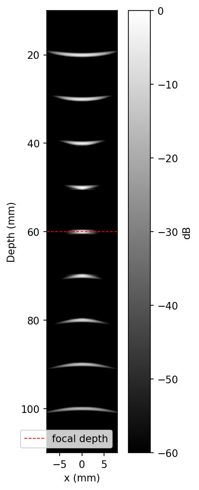

# Learn 08 — A B-mode image, one focused line at a time.



Run it: `uv run examples/learn/08_bmode_line_by_line.py`

```python title="examples/learn/08_bmode_line_by_line.py"
--8<-- "examples/learn/08_bmode_line_by_line.py"
```
