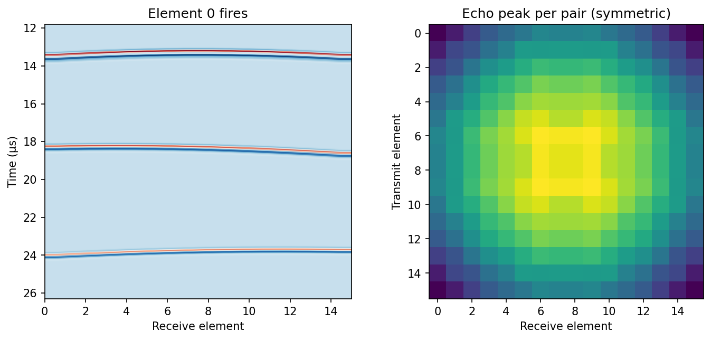

# Learn 09 — Full matrix capture (FMC): every transmit-receive pair.



Run it: `uv run examples/learn/09_full_matrix_capture.py`

```python title="examples/learn/09_full_matrix_capture.py"
--8<-- "examples/learn/09_full_matrix_capture.py"
```
