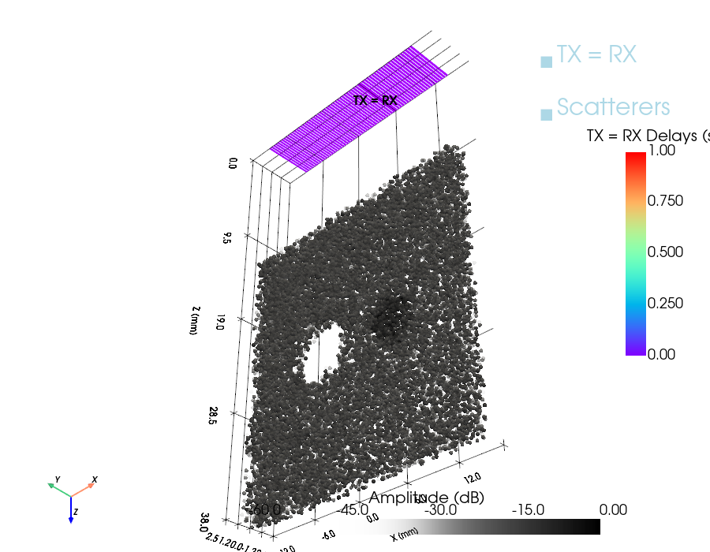
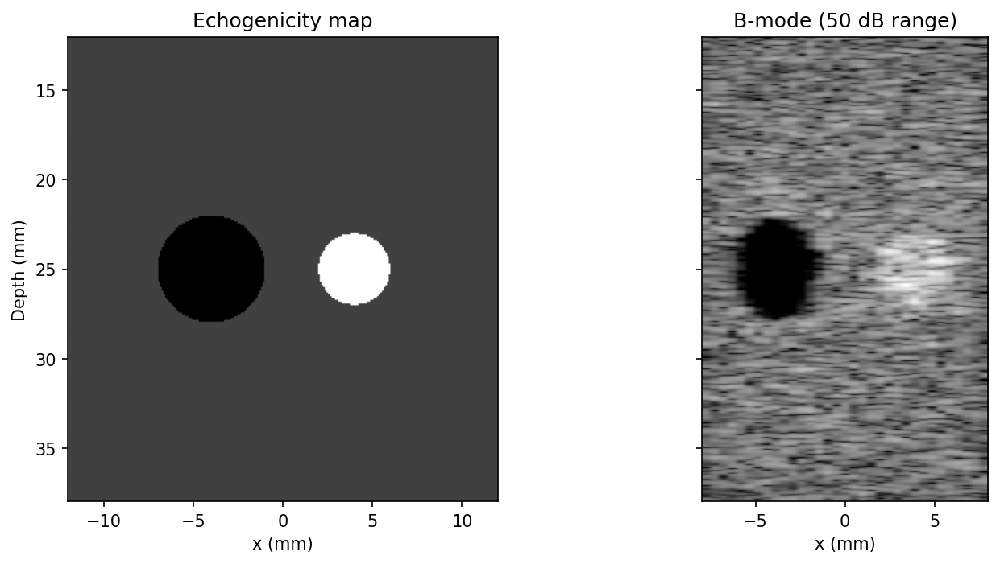

# Learn 10 — Speckle: imaging a tissue-mimicking phantom.




Run it: `uv run examples/learn/10_speckle_phantom.py`

```python title="examples/learn/10_speckle_phantom.py"
--8<-- "examples/learn/10_speckle_phantom.py"
```
