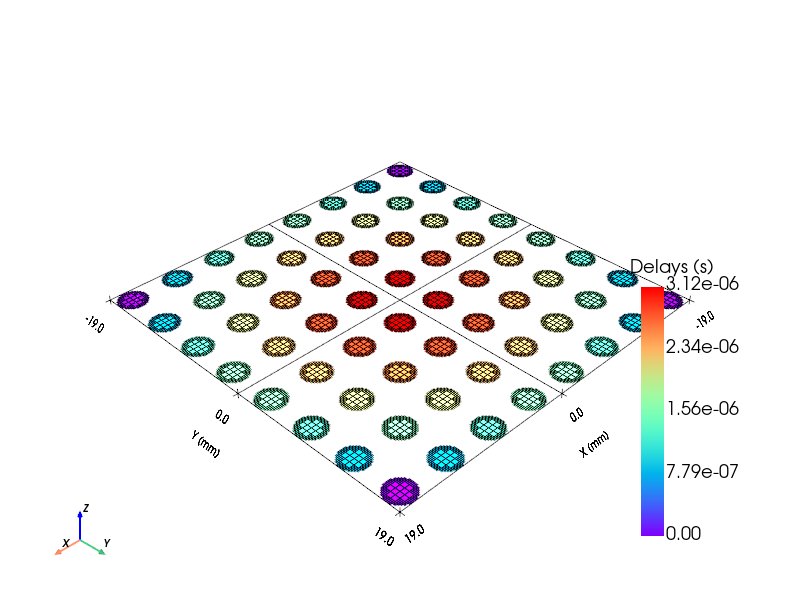
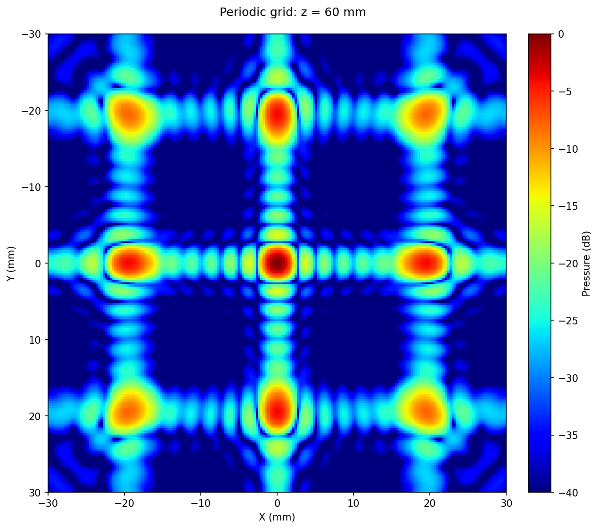
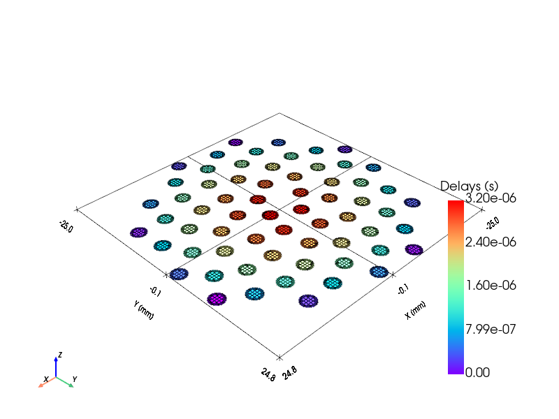
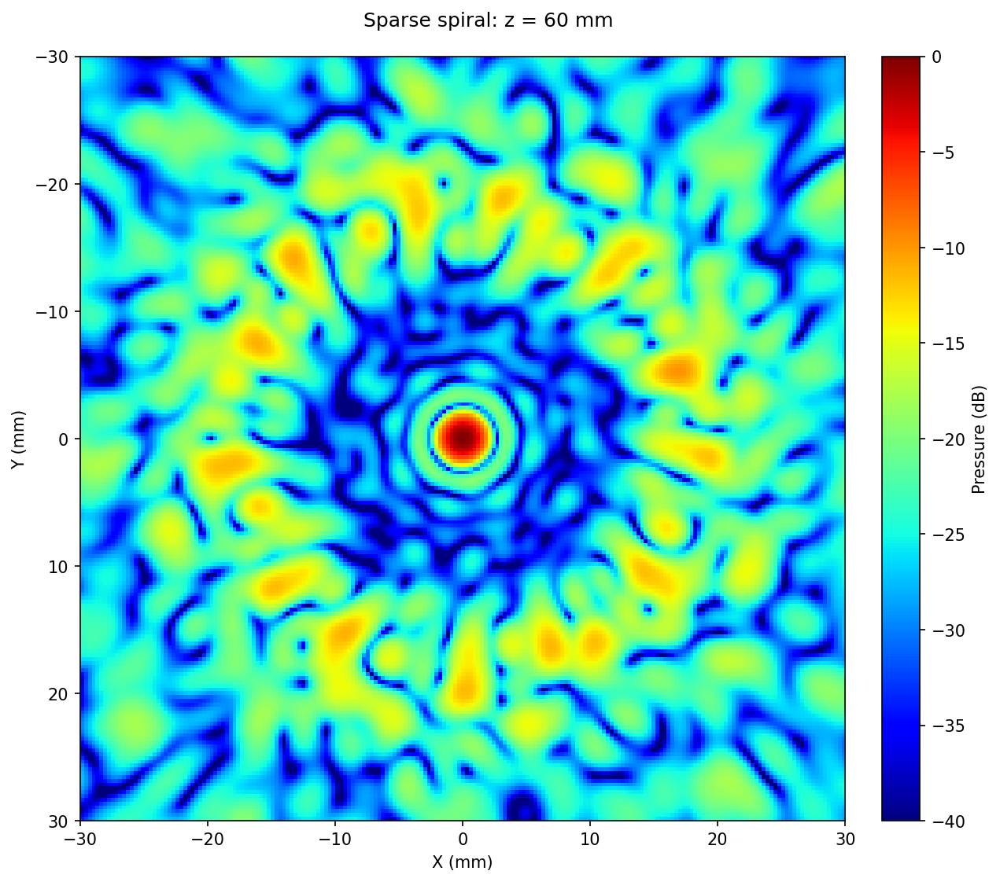

# Learn 11 — Grating lobes: periodic vs sparse spiral arrays.






Run it: `uv run examples/learn/11_sparse_spiral_array.py`

```python title="examples/learn/11_sparse_spiral_array.py"
--8<-- "examples/learn/11_sparse_spiral_array.py"
```
