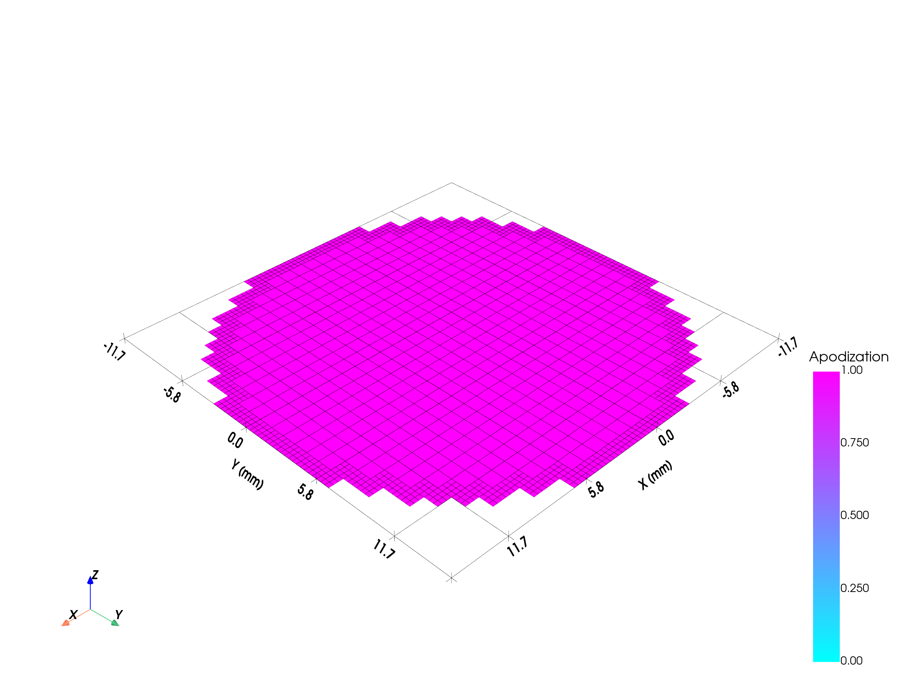
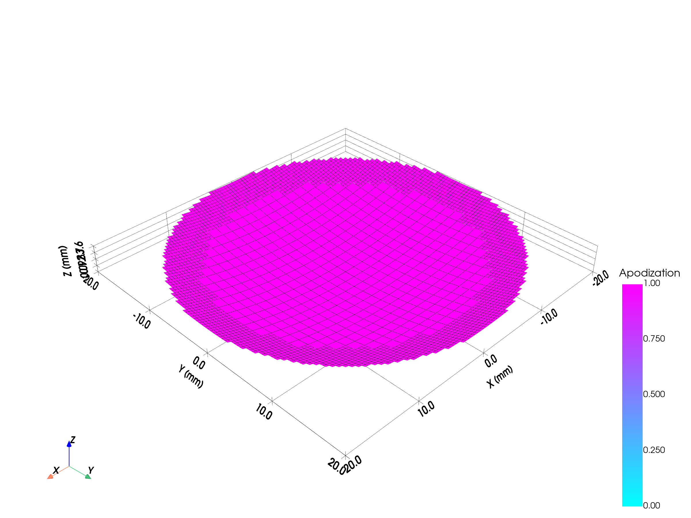
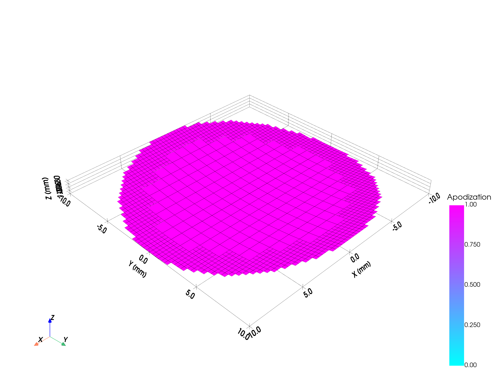

# Mono-element Transducers

Single-element circular transducers. Focusing comes from the physical curvature of
the surface, not electronic delays. See the [Transducers API](../api/transducers.md)
for full parameters and [Example 2 — Mono-element Fields](../examples/example02_monoelements_monochromatic_CW.md).

| | | |
|---|---|---|
|  |  |  |

The radiated pressure fields for these transducers live in the [Emission guide](emission.md).

## At a glance

| Type | Shape | Focusing |
|------|-------|---------|
| `FlatCircularTransducer` | Flat disk | None — diverging field |
| `ConcaveCircularTransducer` | Spherical bowl | Geometric (focus at z > 0) |
| `ConvexCircularTransducer` | Spherical dome | Geometric (diverging) |
| `FocusedCircularTransducer` | Cylindrical arc | Line-focus along one axis |

All mono-element transducers have `n_elements = 1`. Electronic delays have no effect — focusing is achieved through the physical curvature of the surface.

### Z-convention

For all curved circular transducers the **rim is at z = 0**. The `focus_mm` parameter sets the axial depth from the rim to the geometric focus:

```python
tx = ConcaveCircularTransducer(
    diameter_mm=64.0,
    focus_mm=63.0,   # radius of curvature = focal length (datasheet Rfocus)
    frequency_Hz=0.5e6,
    no_sub_diameter=30,
)
```

For the spherical caps `focus_mm` is the **radius of curvature** (= focal length,
the datasheet `Rfocus`): with the apex at `z = 0` the geometric focus lands at
`z = focus_mm`, so here radius and focal depth coincide. `focus_mm = D/2` gives a
hemisphere. (The linear-array `elevation_focus_mm` uses the same radius convention
but a rim datum, so there they *don't* coincide — see
[Multi-element § Elevation lens](multi-elements.md#elevation-lens).)

## Arbitrary radial profiles

`ConcaveCircularTransducer` and `ConvexCircularTransducer` are the two spherical
cases of a more general element: any axisymmetric cap `z(r)`. When the surface is
not a sphere — an aspheric lens, a refractive doublet, a measured profile —
describe it directly with `RadialProfileTransducer`, giving the radial sag as a
callable `z(r)` in mm:

```python
from esdiva.transducers import RadialProfileTransducer

# A shallow convex (diverging) cap: z dips as r grows.
tx = RadialProfileTransducer(
    diameter_mm=0.6,
    surface_sag_mm=lambda r: -0.05 * r**2,   # z(r) in mm, any axisymmetric profile
    frequency_Hz=15e6,
    no_sub_diameter=40,
)
```

It tiles the surface into rectangular patches with the same ring-based
`subdivide_radial` the spherical caps use (see
[Geometry Functions](geometry.md)), so flat piston, bowl, dome and aspheric
profiles share one engine — the circular classes are convenience wrappers around a
fixed spherical `z(r)`. The highest point of the profile is pinned to `z = 0`; a
pure z-shift leaves the far-field directivity unchanged.

For a non-spherical cap there is no single centre of curvature, so a beamformer
cannot assume the aperture plane is the acoustic origin. `tx.virtual_source_m`
returns the point the cap effectively radiates from — the paraxial centre of
curvature, computed from geometry alone (no field simulation) — which is where
delay-and-sum should reference the element. Fitting such a profile to a target
directivity, and using its `virtual_source_m` for imaging, is
[Example 23](../examples/example23_optimize_radial_element.md) and
[Example 24](../examples/example24_multilens_matrix_psf.md).
