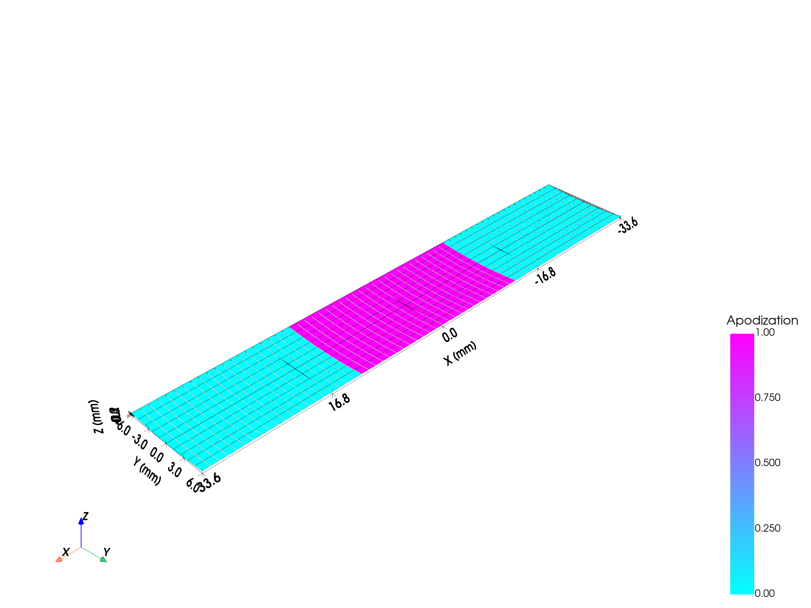
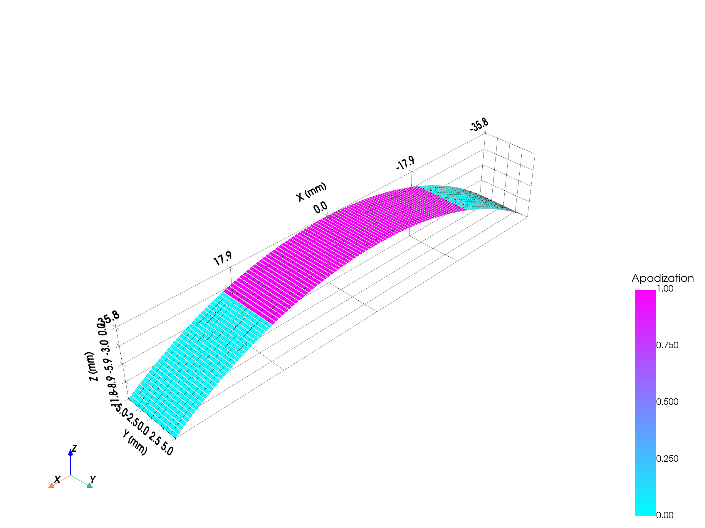
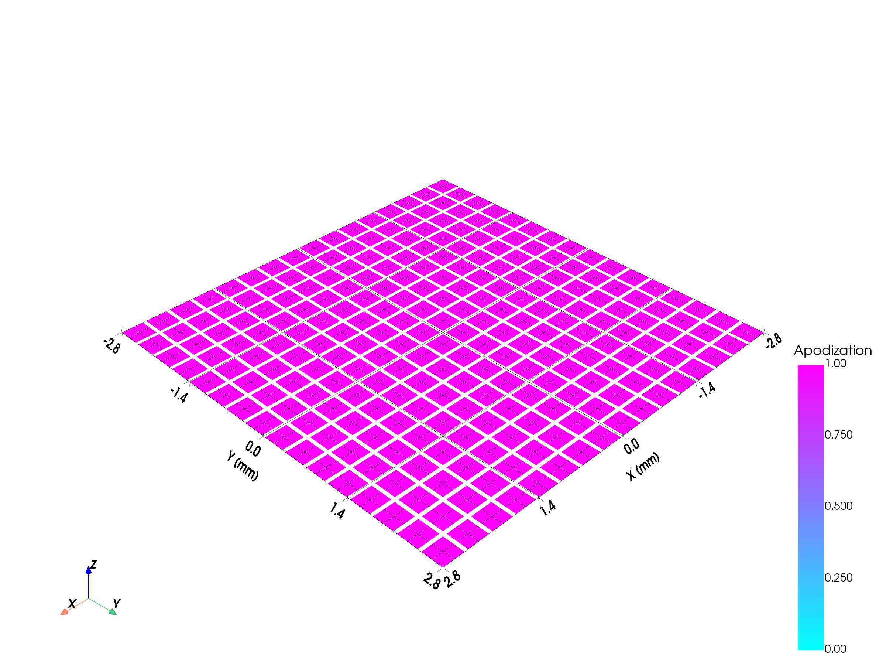
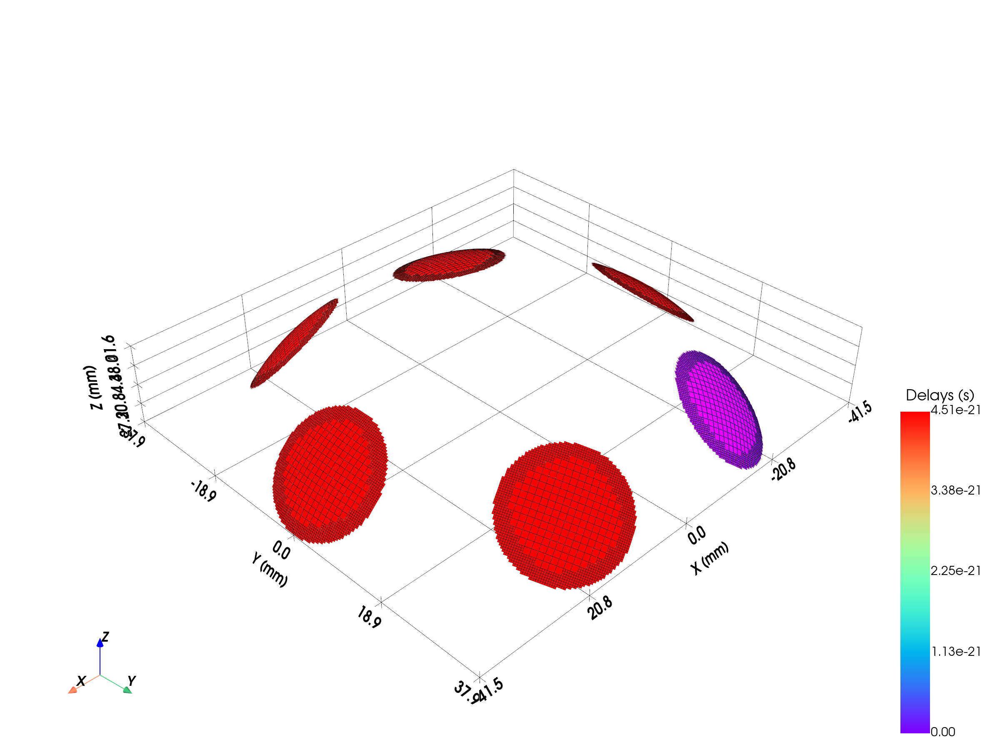

# Multi-element Transducers

Arrays of independently driven elements — electronic steering and focusing via
per-element delays and apodization. See the
[Transducers API](../api/transducers.md) and
[Example 3 — Multi-element 3-D](../examples/example03_multielements_monochromatic_CW.md).

| | |
|---|---|
|  |  |
|  |  |

Radiated pressure fields for these arrays live in the [Emission guide](emission.md).

## At a glance

| Type | Layout | Steering |
|------|--------|---------|
| `LinearArrayTransducer` | 1-D row along X | Lateral + depth (XZ) |
| `ConvexArrayTransducer` | Elements on convex arc | Wide-angle sector |
| `MatrixArrayTransducer` | 2-D grid of elements | Full 3-D volumetric |
| `CustomTransducer` | Arbitrary positions | Per-element definition |

## Basic usage

```python
from esdiva.transducers import LinearArrayTransducer

tx = LinearArrayTransducer(
    n_elements=64,
    element_width_mm=0.25,
    element_height_mm=12.0,
    kerf_mm=0.05,
    no_sub_x=2,
    no_sub_y=4,
    frequency_Hz=5e6,
)

# Focus at (x=0, y=0, z=30 mm)
tx.compute_delays(focus_mm=[0, 0, 30])
tx.compute_apodization(focus_mm=[0, 0, 30], FoverD=2.0)
```

Delays and apodization can be recomputed for any focal point without recreating the transducer object.

## Elevation lens

A linear array focuses electronically in the imaging plane but **not** in
elevation — the out-of-plane direction the image cannot show. Real probes add an
acoustic lens; eSDIva models it as geometry, curving each element's patches onto a
cylindrical arc when you pass `elevation_focus_mm`.

```python
tx = LinearArrayTransducer(
    n_elements=64, element_width_mm=0.108, element_height_mm=4.0,
    kerf_mm=0.002, no_sub_x=1, no_sub_y=6,
    elevation_focus_mm=12.0,          # RADIUS of curvature (not the focal depth)
    frequency_Hz=12.5e6,
)
tx.elevation_focus_depth_mm     # 11.832 mm — where it actually focuses
tx.elevation_lens_sag           # +1.678e-4 m, signed
```

`no_sub_y` must be ≥ 2, or there are no patches to put on the curve.

!!! warning "`elevation_focus_mm` is a radius, like `focus_mm` on the circular transducers"
    It is the lens **radius of curvature** (the datasheet value, the Field II
    `xdc_focused_array` `Rfocus`), *not* the depth the beam converges at. The lens
    face sits at `z = 0`, so the arc's centre of curvature — the point every patch
    is equidistant from, i.e. the true line focus — is one sagitta `h²/(8R)`
    *shallower* than `R` (0.17 mm for a 4 mm aperture at `R = 12 mm`). Read the real
    depth from `elevation_focus_depth_mm`. The mono-element `focus_mm` is the same
    radius convention, but there the apex is the datum, so focus and radius coincide.

**Sign — concave or convex.** Positive curves the surface away from the medium
(concave, converging: an ordinary lens). Negative bulges it into the medium
(convex, diverging), spreading the elevation beam; its focus is virtual and
`elevation_focus_depth_mm` is then negative. A flat aperture returns `inf`.

**Why it matters for measurements.** The elevation beam at the focus is ≈ `λ·z/H`
wide — 0.36 mm for a 4 mm aperture at 12 mm, vs 1.7 mm unfocused at 22 mm. Any
quantity averaged over the resolution cell inherits that width: a Doppler velocity
is the power-weighted mean over the cell, so an unfocused elevation aperture reads
a vessel comparable to the beam as slower than it is. See
[Flow Simulation](flow-simulation.md).

!!! note "The time origin already accounts for the curve"
    The curved surface sits off the `z = 0` plane the beamformer measures depth
    from, so reception subtracts the signed sag (once per aperture) from
    `coords["t0"]`. Nothing to do at the call site — a point target lands at its
    true depth for flat, concave and convex apertures alike. Emission needs no such
    term: its `t0` is a physical origin, not a beamforming reference.
