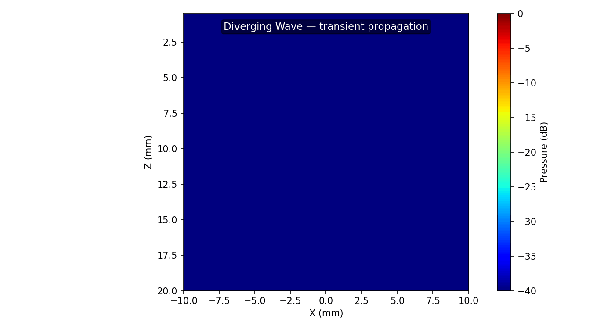

# Transient + Excitation

The SIR is convolved (in the frequency domain) with a user excitation pulse,
giving the full time-domain pressure wavefront `p(t, x, y, z)`. Pass one global
pulse `(L,)` or a per-element pulse `(L, E)`.

```python
from esdiva.emission import Emission
from esdiva.utilities import tone_burst

fs = 200e6
excitation = tone_burst(tx.fc, n_cycles=2, fs=fs)  # Hann-windowed sine at fc.

sim = Emission(tx, fs=fs, excitation=excitation)
p, coords = sim(field_points)
# dict input : p.shape == (Nt, Nx, Ny, Nz), coords has "x","y","z","t0","dt"
```

`p` is the **signed** pressure in pascals (compression > 0, rarefaction < 0) for `rho`
in kg/m³ and the excitation read as a surface velocity in m/s; it does not depend on
`fs`. Peak negative pressure is `-p.min(axis=0)`; take `np.abs(p)` or an envelope for
field maps. If `tx.impulse_response` is set, the velocity is the full `excitation ⊛ ir`.



## When to use

- Realistic pulsed propagation waveforms (DW, steered PW, focused).
- Acoustic intensity / heating maps.
- Comparing pulse shapes and their effect on the focal pattern.

See [Example 4 — Diverging Wave](../examples/learn/04_plane_vs_diverging_wave.md)
and [Example 5 — Steered Plane Wave](../examples/applications/matrix_steered_pw_3d.md).
